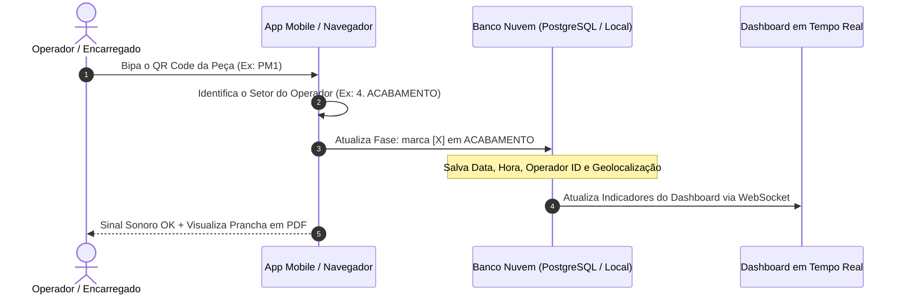

# 🏷️ Especificação do Sistema de Rastreabilidade & Dashboard Inicial (RBR Pré-Fabricados)

---

## 1. 📌 Modelo da Etiqueta de Rastreabilidade ZPL

A etiqueta contém todos os campos do padrão atual da RBR, acrescida da matriz dos **8 quadradinhos de marcação visual por fase**.

```
+-----------------------------------------------------------------------------+
|                     RBR PRÉ-FABRICADOS DE CONCRETO                          |
|                     ETIQUETA DE RASTREABILIDADE - PCP                       |
+-----------------------------------------------------------------------------+
  DATA CONCRETAGEM: 2025-09-12
  OBRA: 010 - 25 - NEZINHO - ANGATUBA - SP
  FÔRMA / PISTA: PILAR 1  |  CÓD. CONTROLE PCP: 327
-------------------------------------------------------------------------------
  NOME DA PEÇA: PM1
  PRODUTO / GRUPO: PILAR / PILAR
  SEÇÃO TRANSVERSAL: 40X40          | COMPRIMENTO: 10.3 m
  VOLUME CONCRETO: 1.588 m³         | PESO REAL: 3,902.27 kg
  TRAÇO / Fck: GINO                 | COBRIMENTO AÇO: 2,5 cm
  TAXA DE AÇO: 107.349 kg/m³
-------------------------------------------------------------------------------
  FASES DE CONTROLE DE PRODUÇÃO:                   +-----------------------+
  [X] 1. CORTE E DOBRA    [X] 5. EXPEDIÇÃO         |                       |
  [X] 2. ARMAÇÃO          [ ] 6. LOGÍSTICA         |    [  QR CODE  ]      |
  [X] 3. CONCRETAGEM      [ ] 7. RECEBIMENTO OBRA  |   RBR_PCP:327:PM1     |
  [ ] 4. ACABAMENTO       [ ] 8. EXECUÇÃO OBRA     |                       |
                                                   +-----------------------+
-------------------------------------------------------------------------------
  RBR OpenPrecast ERP — Rastreabilidade em Tempo Real
+-----------------------------------------------------------------------------+
```

---

## 2. 📲 Mecanismo de Bipagem & Atualização Automática das Fases

Cada vez que o profissional de um setor aciona o leitor de QR Code (no celular, tablet ou coletor), o sistema **valida quem é o operador**, **registra a data/hora exata** e **marca automaticamente o quadradinho `[X]` da fase atual**:



---

## 3. 📊 Protótipo do Dashboard Inicial de Rastreabilidade

O **Dashboard Inicial** fornece ao gestor a visão panorâmica de todas as obras e o avanço físico detalhado peça por peça através das 8 etapas:

```
+----------------------------------------------------------------------------------------------------+
| 📊 RBR PRECAST — DASHBOARD DE RASTREABILIDADE DE OBRAS E PRODUÇÃO                                  |
+----------------------------------------------------------------------------------------------------+
| [ Obras Ativas: 15 ]   [ Peças em Produção: 2.163 ]   [ Volume Total: 4.035 m³ ]   [ Concluídas: 84% ]|
+----------------------------------------------------------------------------------------------------+

 🔄 FUNIL DE RASTREABILIDADE POR ETAPA (2.163 PEÇAS)

 1. CORTE E DOBRA     [==================================================] 100% (2.163 / 2.163)
 2. ARMAÇÃO          [===============================================>  ]  92% (1.990 / 2.163)
 3. CONCRETAGEM      [===========================================>      ]  85% (1.838 / 2.163)
 4. ACABAMENTO       [=======================================>          ]  78% (1.687 / 2.163)
 5. EXPEDIÇÃO        [===================================>              ]  70% (1.514 / 2.163)
 6. LOGÍSTICA        [===============================>                  ]  62% (1.341 / 2.163)
 7. RECEBIMENTO OBRA [===========================>                      ]  55% (1.189 / 2.163)
 8. EXECUÇÃO NA OBRA [======================>                           ]  45% (  973 / 2.163)

----------------------------------------------------------------------------------------------------

 📌 STATUS DAS OBRAS EM EXECUÇÃO

  OBRA                                  PEÇAS    CONCRETADAS   EXPEDIDAS   MONTADAS   PROGRESSO
 ---------------------------------------------------------------------------------------------------
  010-25 - NEZINHO - ANGATUBA-SP          140        140          120         110      [=======> ] 85%
  110-25 - TMS RODOVIÁRIA - SOROCABA      320        280          210         180      [=====>   ] 65%
  148-24 - JVR 03 - SOROCABA-SP           230        230          230         230      [=========] 100%
  002-26 - FERNANDO SCOCHA V - SP         450        180           90          40      [==>      ] 30%
----------------------------------------------------------------------------------------------------
```

---

## 4. 🏷️ Código ZPL Gerado Nativamente para Impressoras Zebra

```zpl
^XA
^PW800^LL1200^CF0,24
^FO40,30^GB720,70,3^FS
^FO60,45^A0N,28,28^FDRBR PRÉ-FABRICADOS DE CONCRETO^FS
^FO60,75^A0N,20,20^FDETIQUETA DE RASTREABILIDADE - PCP^FS

^FO40,115^A0N,22,22^FDOBRA: 010 - 25 - NEZINHO - ANGATUBA - SP^FS
^FO40,145^A0N,22,22^FDCONCRETAGEM: 2025-09-12 | PISTA: PILAR 1^FS
^FO40,175^A0N,22,22^FDCÓD. CONTROLE PCP: 327^FS
^FO40,210^GB720,2,2^FS

^FO40,225^A0N,32,32^FDPEÇA: PM1^FS
^FO40,265^A0N,22,22^FDPRODUTO: PILAR / PILAR^FS
^FO40,295^A0N,22,22^FDSEÇÃO: 40X40 | COMPRIMENTO: 10.3 m^FS
^FO40,325^A0N,22,22^FDVOL. CONCRETO: 1.588 m3 | PESO: 3,902.27 kg^FS
^FO40,355^A0N,22,22^FDTRAÇO/Fck: GINO | COBRIMENTO: 2,5 cm^FS
^FO40,385^A0N,22,22^FDTAXA AÇO: 107.349 kg/m3^FS
^FO40,420^GB720,2,2^FS

^FO520,440^BQN,2,8^FDQA,RBR_PCP:327:PM1^FS

^FO40,435^A0N,22,22^FDFASES DE PRODUÇÃO:^FS
^FO40,470^A0N,20,20^FD[X] 1. CORTE E DOBRA^FS
^FO40,500^A0N,20,20^FD[X] 2. ARMAÇÃO^FS
^FO40,530^A0N,20,20^FD[X] 3. CONCRETAGEM^FS
^FO40,560^A0N,20,20^FD[ ] 4. ACABAMENTO^FS
^FO280,470^A0N,20,20^FD[ ] 5. EXPEDIÇÃO^FS
^FO280,500^A0N,20,20^FD[ ] 6. LOGÍSTICA^FS
^FO280,530^A0N,20,20^FD[ ] 7. RECEBIMENTO OBRA^FS
^FO280,560^A0N,20,20^FD[ ] 8. EXECUÇÃO OBRA^FS

^FO40,640^GB720,2,2^FS
^FO40,650^A0N,18,18^FDRBR OpenPrecast ERP - Rastreabilidade em Tempo Real^FS
^XZ
```
